# Manual de uso do Camaleão Admin

Sistema do Brechó Camaleão e das doações do Instituto Camaleão. Ele registra vendas, doações e apoiadores numa ficha única e mostra quantos atendimentos a pacientes em tratamento de câncer cada contribuição ajuda a custear (1 atendimento a cada R$ 50).

**Para quem é este manual:** coordenação, caixa e voluntária do Instituto. Cada parte diz quem usa a tela.

**Os três perfis:**

| Perfil | O que faz no sistema |
| --- | --- |
| **Coordenação** | Tudo: relatórios, cadastros, equipe, correções de qualquer data e aprovação do termo de mensagens |
| **Caixa** | Vendas do brechó, doações em dinheiro e de item, fichas, correção de lançamentos e agradecimentos |
| **Voluntária** | Doações de item (entrada e triagem) e fichas |

> **Como ler cada tela:** para que serve, quem usa, passo a passo, um print e os cuidados (o que o sistema recusa e por quê).

<!--
Para quem escreve: prints em docs/manual/imagens/, nome NN-tela.png (ex.: 03-nova-venda.png),
tirados do sistema publicado com as contas de conferência e registros "CONFERÊNCIA".
Nenhum dado real em print. Sem termos técnicos. Sem travessão.
-->

## Sumário

1. Primeiros passos
2. Voluntária: doações de item
3. Caixa: brechó e dinheiro
4. Caixa: corrigir e agradecer
5. Fichas
6. Coordenação: relatórios
7. Coordenação: cadastros
8. Perguntas frequentes

---

## 1. Primeiros passos

### Entrar no sistema

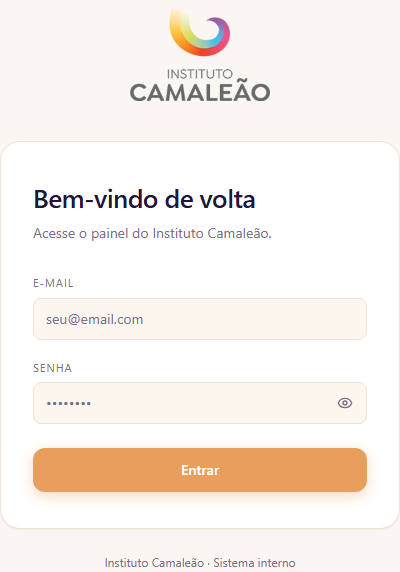

1. Abra no navegador o link do **Camaleão Admin** fornecido pela coordenação.
2. Na tela **Bem-vindo de volta**, preencha **E-mail** e **Senha** com os dados da sua conta. Se for seu primeiro acesso ou se a coordenação tiver gerado uma nova senha provisória, digite a senha provisória que recebeu por mensagem individual.
3. Toque em **Entrar**.

### Criar sua senha no primeiro acesso

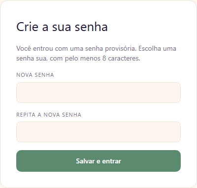

1. Na tela **Crie a sua senha**, digite uma senha com pelo menos 8 caracteres em **Nova senha**.
2. Digite a mesma senha em **Repita a nova senha**.
3. Toque em **Salvar e entrar**. Nos próximos acessos, use a senha que você criou.

### Navegar e sair

No computador, o menu fica à esquerda. No celular, toque no ícone de três linhas para abrir o menu. Ao abrir **Brechó**, **Doações** ou **Clientes**, aparecem as opções disponíveis para o seu perfil.

| Perfil | Tela inicial | Menus |
| --- | --- | --- |
| **Coordenação** | Brechó · Visão geral | **Brechó** (Visão geral, Nova venda, Corrigir lançamento, Financeiro), **Doações** (Dinheiro, Itens, Eventos, Campanhas, Categorias, Sem ficha), **Clientes** (Fichas, Possíveis repetidos, Aniversariantes, Doadores recorrentes, Importar planilha, Agradecimentos), **Relatórios** e **Equipe** |
| **Caixa** | Brechó · Visão geral | **Brechó** (Visão geral, Nova venda, Corrigir lançamento), **Doações** (Dinheiro, Itens) e **Clientes** (Fichas, Agradecimentos) |
| **Voluntária** | Doações · Itens | **Doações** (Itens) e **Clientes** (Fichas) |

| Menu da Coordenação | Menu do Caixa | Menu da Voluntária |
| --- | --- | --- |
| 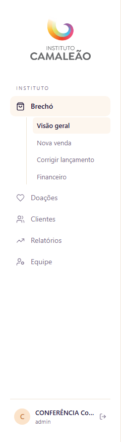 | 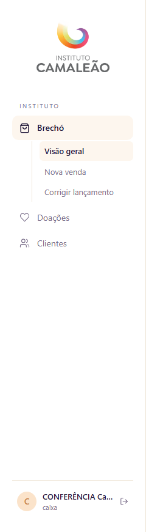 | 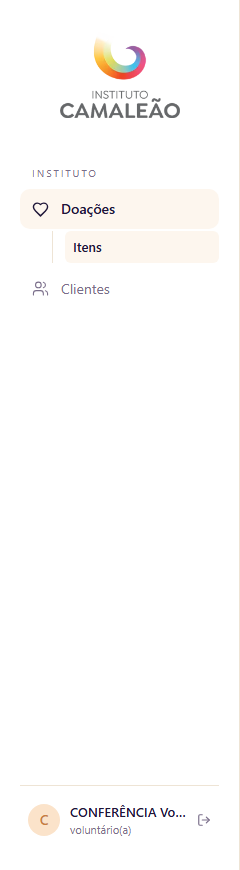 |

Para encerrar a sessão, toque no ícone **Sair**, ao lado do seu nome no rodapé do menu.

---

## 2. Voluntária: doações de item

*A escrever: Bibiana (nova doação de item, triagem com aproveitadas, redoadas e descarte, editar e excluir, recibo de item, doações sem ficha).*

---

## 3. Caixa: brechó e dinheiro

**Quem usa:** caixa e coordenação. A voluntária não vê o Brechó nem as doações em dinheiro.

### 3.1 Registrar uma venda

**Para que serve:** registrar cada venda do brechó, com as peças, a forma de pagamento e, se a pessoa quiser, a ficha dela.

1. No menu, **Brechó** e depois **Nova venda** (ou o botão **Registrar venda** no painel do brechó).
2. **Cliente:** digite o nome, o apelido ou os 4 últimos dígitos do telefone. A busca acha o nome mesmo sem acento. Ao lado de cada nome aparece "já comprou", "já doou" ou "primeira vez". Toque na pessoa.
   - A pessoa não tem ficha? Use **Cadastrar** na própria busca (veja 5.2).
   - A pessoa não quer se identificar? Deixe em branco: a venda fica como **Cliente avulso**.
3. **Data da venda:** já vem com hoje. Só mude se estiver lançando uma venda de outro dia (aparece "Registrando com data retroativa"). Não aceita data futura.
4. **Peças:** toque num dos **Mais vendidos** para pôr a peça com o valor de sempre, ou use **Adicionar peça** e escreva a categoria (saia, blusa, vestido...) e o valor. O **X** tira a peça.
5. **Forma de pagamento:** PIX, Crédito, Débito ou Dinheiro.
   - No cartão e no PIX pela maquininha, escolha o **banco ou maquininha**.
   - No crédito, escolha as **parcelas** (1x a 6x).
   - No débito da PagBank, escolha a **bandeira**.
6. Confira o **Resumo** à direita (pessoa, peças e total) e toque em **Registrar venda**.
7. O painel do brechó mostra "Venda de R$ ... registrada" e quantos atendimentos ela ajuda a custear.

**Cuidados:**
- Sem nenhuma peça com valor, o botão não funciona.
- A internet caiu e apareceu "Não foi possível registrar a venda"? Confira **Últimas vendas**, no painel do brechó, **antes** de registrar de novo, para não lançar duas vezes.
- Lançou errado? A venda não se corrige campo a campo: cancele (parte 4) e registre de novo.

### 3.2 Painel do brechó e Financeiro

- **Painel (Brechó · Visão geral):** vendas de hoje, quantas vendas e as **Últimas vendas**. A coordenação vê também a semana e o mês.
- **Financeiro:** a coordenação consulta as vendas de todos os dias, com forma de pagamento, parcelas, banco e taxa da maquininha. No **Painel do brechó**, o caixa consulta as vendas do dia. Para localizar uma venda de outra data e cancelá-la, use **Corrigir lançamento** (parte 4.1).

### 3.3 Registrar uma doação em dinheiro

**Para que serve:** registrar doação em espécie, transferência, PIX ou cartão, com o valor que de fato chega ao Instituto depois da taxa da maquininha.

1. No menu, **Doações**, depois **Dinheiro** e **Nova doação**.
2. **Doador:** busque a pessoa como na venda. Se a pessoa não tem ficha e não quer cadastrar, marque **doação sem ficha** e escreva o nome (ou "Anônimo") e, se quiser, o telefone.
3. **Data** (já vem com hoje; não aceita data futura) e **Valor**.
4. **Origem:** de onde veio a doação.
5. **Recebido por:** "Sem maquininha (espécie ou transferência)" ou a maquininha. Com maquininha, escolha a **Forma** e, no débito da PagBank, a **Bandeira**.
6. **Evento** ou **Campanha**, se a doação foi para um deles (um ou outro, nunca os dois).
7. **Frequência** (pontual ou mensal) e **Observações**, se quiser.
8. Confira o **Resumo**: com maquininha de cartão, aparece o **Líquido estimado** (o valor depois da taxa). Os atendimentos contam pelo líquido.
9. Toque em **Registrar doação**.

**Cuidados:**
- **Valor muito alto:** o sistema pergunta "Confira se não sobrou um zero. O valor está certo?". Confira antes de confirmar.
- A taxa usada é a que está cadastrada em Relatórios · Taxas (parte 7). Sem taxa cadastrada para aquela maquininha (por exemplo, a Doação Solutions, enquanto a taxa não for informada), o líquido fica em branco.

### 3.4 Recibo

**Para que serve:** entregar ou enviar à pessoa o comprovante da doação, com a razão social, o CNPJ, o logo e o lugar da assinatura do Instituto.

1. Na lista de doações em dinheiro (ou de item), toque em **Recibo** na linha da doação.
2. Confira os dados e use **Imprimir** (ou salve em PDF pela janela de impressão).
3. Assine no lugar indicado.

**Cuidados:**
- O caixa abre o recibo das doações **de hoje**; recibos de outros dias, só a coordenação.
- Doação de item com a triagem pendente sai "com a quantidade a confirmar na triagem".

---

## 4. Caixa: corrigir e agradecer

### 4.1 Corrigir lançamento

**Quem usa:** Caixa e Coordenação podem corrigir doações em dinheiro e cancelar doações em dinheiro ou vendas de hoje e de dias anteriores. A Voluntária tem acesso às doações de itens e às fichas.

**Localizar uma venda ou doação**

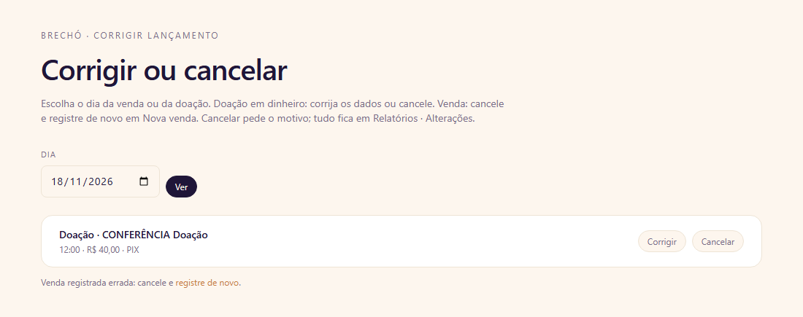

1. Abra **Brechó** e toque em **Corrigir lançamento**. A tela **Corrigir ou cancelar** abre com os lançamentos de hoje.
2. No campo **Dia**, escolha a data da venda ou da doação e toque em **Ver**. Use a data que consta no lançamento, mesmo que ele tenha sido digitado em outro dia.
3. Confira o tipo (**Venda** ou **Doação**), o nome, o horário e o valor para identificar a linha certa. Em **Doações · Dinheiro**, o Caixa também encontra **Corrigir** e **Cancelar** nas doações do dia, na lista **Doações registradas**.

**Corrigir uma doação em dinheiro**

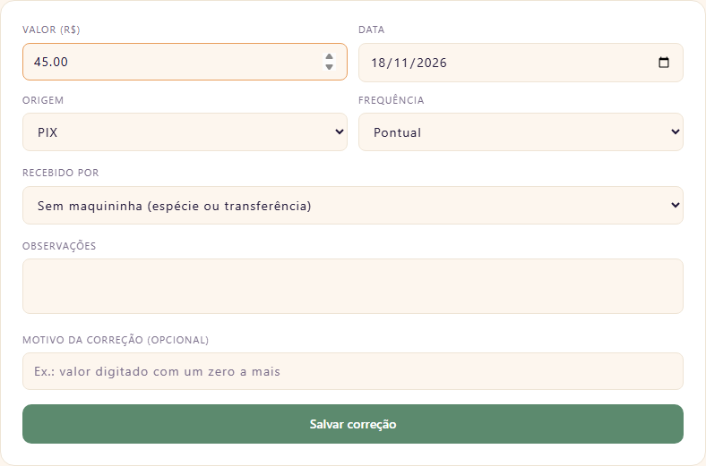

1. Na linha da doação, toque em **Corrigir**.
2. Ajuste os campos necessários. Você pode corrigir **Valor (R$)**, **Data**, **Origem**, **Frequência**, **Recebido por** e **Observações**. Conforme a opção escolhida em **Recebido por**, aparecem os campos **Forma** e **Bandeira**.
3. Se quiser, preencha **Motivo da correção (opcional)**. O valor precisa ser maior que zero e a data deve ser de hoje ou anterior.
4. Toque em **Salvar correção**. Ao voltar à lista, confira os dados atualizados. Se mudou a **Data**, escolha o novo dia e toque em **Ver** para encontrar a doação.

**Cancelar um lançamento**

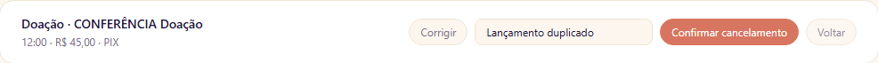

1. Confira a linha do lançamento e toque em **Cancelar** para uma doação ou **Cancelar venda** para uma venda.
2. Preencha **Motivo do cancelamento** com pelo menos 5 caracteres. Por exemplo, escreva “lançamento duplicado”.
3. Toque em **Confirmar cancelamento** e confira se a linha saiu da lista. Se abriu o cancelamento por engano, toque em **Voltar** antes de confirmar.

**Venda registrada com erro:** use **Cancelar venda** e, depois de confirmar, abra **Brechó · Nova venda** para registrar a venda com os dados certos. Se o motivo do cancelamento foi um lançamento duplicado, mantenha apenas a venda original.

A Coordenação pode consultar quem fez cada correção ou cancelamento e o motivo informado em **Relatórios · Alterações**.

### 4.2 Agradecer (Clientes · Agradecimentos)

**Para que serve:** agradecer pelo WhatsApp ou pelo e-mail quem apoiou o Instituto, com a mensagem pronta. São três agradecimentos, como o Instituto já faz: o **mensal**, para quem comprou no brechó ou doou dinheiro; o **semanal**, para quem trouxe doação na sede; e o **anual**, para todo mundo que contribuiu no ano.

**Quem usa:** caixa e coordenação.

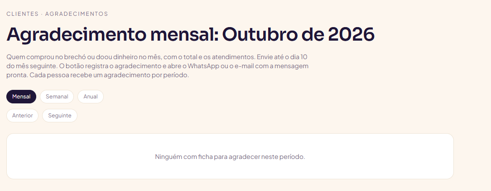

1. No menu, **Clientes**, depois **Agradecimentos**.
2. Escolha a aba:
   - **Mensal:** abre no **mês anterior**, porque o agradecimento do mês é enviado até o dia 10 do mês seguinte. Mostra quem comprou no brechó ou doou dinheiro, com o total e os atendimentos que ajudou a custear.
   - **Semanal:** abre na **semana anterior** (de segunda a domingo). Mostra quem trouxe doação na sede (tampinhas, roupas e outros), mesmo que a triagem ainda não tenha sido feita. A mensagem é padrão e não diz o que a pessoa doou.
   - **Anual:** abre no **ano atual**. Mostra todo mundo que contribuiu no ano. Quem comprou ou doou dinheiro recebe o total e os atendimentos; quem só doou item recebe um texto de agradecimento sem valores.
3. Use **Anterior** e **Seguinte** para ver outro mês, outra semana ou outro ano.
4. Na linha da pessoa, toque em **WhatsApp** ou **E-mail**. O sistema registra o agradecimento e abre o WhatsApp (ou o e-mail) com a mensagem pronta.
5. Confira a mensagem e envie.
6. A linha passa a mostrar **Agradecida em** (data e canal).

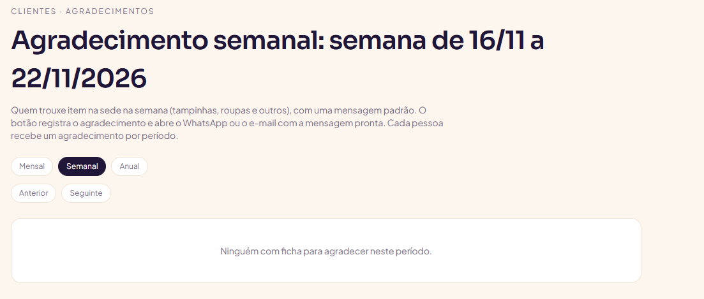

**O que a linha diz quando não há botão:**

| A linha diz | O que fazer |
| --- | --- |
| Agradecida em... | Nada: a pessoa já foi agradecida neste período |
| Sem autorização de mensagens | Só pode receber se autorizar. Peça a autorização na ficha (parte 5.3) |
| Autorizou um termo que não vale (veja a ficha) | A pessoa autorizou pelo texto antigo. Leia o termo atual para ela e registre de novo na ficha (parte 5.3) |
| Autorizou; falta a coordenação aprovar o termo | A coordenação precisa registrar a aprovação do termo (parte 7.10) |
| Autorizou, mas não tem contato registrado | Falta telefone com DDD ou e-mail na ficha |

**Cuidados:**
- **Um agradecimento por pessoa em cada período:** uma vez no mês, uma vez na semana e uma vez no ano. Se outra pessoa da equipe já agradeceu, o sistema avisa "Esta pessoa já foi agradecida neste período".
- **O agradecimento fica registrado no toque do botão,** antes de a mensagem sair. Se o WhatsApp não abrir ou você desistir de enviar, ele continua registrado: envie a mensagem por fora ou avise a coordenação.
- O sistema recusa agradecimento que não combina com a contribuição: na aba Semanal, só quem trouxe item; na Mensal, só quem comprou ou doou dinheiro.
- O telefone e o e-mail não aparecem na lista. O sistema busca o contato só no momento do envio.
- Todas as mensagens terminam com "Se não quiser mais receber mensagens do Instituto, é só responder SAIR". Quem responder SAIR deve ter a autorização retirada na ficha (parte 5.3).
- Antes da aprovação do termo, a coordenação vê o formulário **Registrar aprovação** no topo da tela (parte 7.10). O caixa vê o aviso "O termo de mensagens ainda não foi aprovado" e não consegue agradecer ninguém.

---

## 5. Fichas

**Quem usa:** todos os perfis veem e cadastram fichas. Repetidos, mesclagem e importação são só da coordenação.

A **ficha** é a pessoa: tudo o que ela comprou e doou fica num lugar só, e é dela que sai a autorização de mensagens.

### 5.1 Buscar uma pessoa

1. Em **Clientes · Fichas**, ou no campo de pessoa da venda e da doação, digite:
   - parte do nome, com ou sem acento ("claudia" acha "Cláudia");
   - o apelido;
   - ou os **4 últimos dígitos** do telefone (ou o telefone inteiro).
2. Toque no nome para abrir a ficha (ou para escolher a pessoa na venda e na doação).

**Cuidados:**
- Com menos de 4 dígitos, a busca não procura por telefone.
- O caixa e a voluntária veem só o final do telefone; a coordenação vê o número inteiro.

### 5.2 Cadastrar uma pessoa

1. Em **Clientes**, ou pelo **Cadastrar** da busca na venda e na doação.
2. Preencha **nome** (obrigatório) e, se a pessoa quiser, **apelido** (como ela é conhecida no Instituto), **telefone com DDD**, **aniversário** (dia e mês) e **e-mail**.
3. **Autorização de mensagens:** leia para a pessoa o texto do termo que aparece na tela e marque a resposta dela (veja 5.3).
4. Toque em **Cadastrar**.

**Cuidados:**
- Antes de cadastrar, busque: se a pessoa já tem ficha, use a que existe (fichas repetidas atrapalham a soma do que ela fez).
- Telefone sem DDD não serve para o WhatsApp.

### 5.3 Autorização de mensagens

**Para que serve:** registrar se a pessoa aceita receber mensagens do Instituto (agradecimentos, campanhas, eventos e prestação de contas), como pede a lei de proteção de dados.

1. Na ficha da pessoa, veja a situação: "Ainda não foi perguntada", autorizou ou não autorizou.
2. Leia o termo **inteiro** para a pessoa, do jeito que está na tela.
3. Registre a resposta. O sistema grava a data, a versão do termo e quem registrou.
4. A pessoa mudou de ideia? Use **Retirar autorização** na ficha. Ela sai das listas de mensagens na hora, e o histórico continua guardado.

**Cuidados:**
- **Sem autorização, a pessoa não recebe nenhuma mensagem.**
- Quem autorizou pela versão antiga do termo (`2026-10`) aparece com um aviso na ficha: é preciso perguntar de novo, pela versão atual.
- Os agradecimentos só são liberados depois de a coordenação registrar a aprovação do termo pelo Instituto (parte 7).

### 5.4 Ficha e histórico

- **Resumo:** compras, total gasto, doações e o total em **atendimentos** que a pessoa ajudou a custear.
- **Histórico:** compras e doações (em dinheiro, de item, de evento e de campanha) numa lista só, com a data e o tipo.
- **Contribuição no período:** escolha as datas e veja o que a pessoa comprou e doou naquele intervalo.
- **Editar:** corrige nome, apelido, telefone, aniversário e e-mail.

### 5.5 Possíveis repetidos e mesclagem (coordenação)

**Para que serve:** juntar duas fichas da mesma pessoa, para o histórico e as somas ficarem certos.

1. Em **Clientes · Possíveis repetidos**, o sistema mostra pares de fichas parecidas e o motivo (nome parecido, mesmo final de telefone...).
2. Toque no par para ir à **mesclagem**.
3. Escolha a **ficha que fica** e a **ficha que sai**. Confira a prévia, em **O que vai acontecer**: compras, doações, etiquetas e autorização vão para a ficha que fica.
4. Confirme. A ficha que sai deixa de aparecer.
5. Mesclou errado? Use **Desfazer**: as duas fichas voltam como eram. Cada mesclagem só se desfaz uma vez.

### 5.6 Importar planilha (coordenação)

**Para que serve:** trazer de uma vez os apoiadores que o Instituto já tem em planilha. Feito uma vez, no início do uso, pela coordenação.

1. Em **Clientes · Importar planilha**, baixe a **planilha modelo** para ver as colunas (nome, telefone, aniversário...).
2. Escolha o arquivo. O sistema acha as colunas pelo título e mostra, antes de importar, cada linha com a **situação**: vai entrar, "Já tem ficha", "Repetida na planilha" ou "Sem nome".
3. Confira e importe. No fim, aparece o que entrou e o que ficou de fora.

**Cuidados:**
- Telefone sem DDD ganha o 51, com aviso; texto no lugar do telefone é ignorado.
- Quem já tem ficha (mesmo telefone) não é importado de novo.
- A importação **não** registra autorização de mensagens: cada pessoa importada precisa ser perguntada.

---

## 6. Coordenação: relatórios

Tudo nesta parte é **só da coordenação**. No menu, **Relatórios**.

### 6.1 Visão consolidada

**Para que serve:** ver quanto o Instituto arrecadou num período, somando o brechó, as doações em dinheiro e as doações de item.

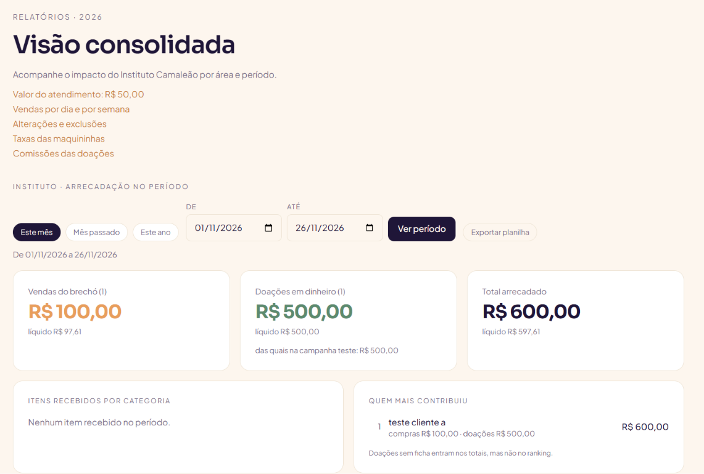

1. No menu, **Relatórios**. A tela abre em **Este mês**.
2. Escolha o período: **Este mês**, **Mês passado** ou **Este ano**. Para outro período, preencha **De** e **Até** e toque em **Ver período**.
3. Confira os quadros:
   - **Vendas do brechó** e **Doações em dinheiro:** a quantidade, o valor e o **líquido** (depois da taxa da maquininha). Quando aparecer "sem taxa cadastrada", o líquido daquele lançamento ficou em branco: cadastre a taxa (parte 7.2).
   - Abaixo das doações, o quanto entrou em cada **evento** e **campanha** do período.
   - **Total arrecadado:** o total, o líquido e, se houver, as **comissões** e o **resultado** (o líquido menos as comissões).
   - **Itens recebidos por categoria:** doações, peças, peso e o resultado da triagem (aproveitadas, redoadas, descarte e triagem pendente).
   - **Quem mais contribuiu:** as pessoas com ficha que mais compraram e doaram no período.
4. Mais abaixo, a **evolução mensal** do brechó e as **formas de pagamento** do mês.

**Cuidados:**
- Doações **sem ficha** entram nos totais, mas não no ranking de quem mais contribuiu.
- Vendas e doações **canceladas** não entram em nenhum total.
- Os atendimentos usam o **valor do atendimento** que aparece no topo da tela (hoje, R$ 50). Para mudar esse valor, veja a parte 7.3.

### 6.2 Exportar planilha

**Para que serve:** baixar o relatório do período numa planilha, para guardar, prestar contas ou montar outros controles.

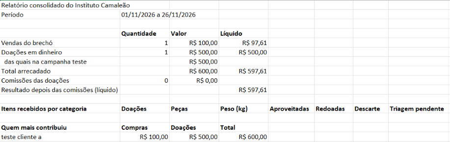

1. Na **Visão consolidada**, escolha o período (passo 2 da parte 6.1).
2. Toque em **Exportar planilha**. O arquivo (`relatorio-AAAA-MM-DD-a-AAAA-MM-DD.xlsx`) vai para a pasta de downloads.
3. Abra no Excel, no Google Planilhas ou no LibreOffice. A planilha tem uma aba para cada assunto: **Resumo**, **Vendas**, **Doações em dinheiro**, **Doações de itens**, **Eventos**, **Campanhas** e **Comissões**.

**Cuidados:**
- A planilha traz **nomes de pessoas**. Guarde em lugar seguro e não envie em grupos.
- A planilha mostra o período escolhido na tela. Confira as datas antes de exportar.

### 6.3 Vendas por dia e por semana

**Para que serve:** ver como as vendas do brechó se distribuem nos dias e nas semanas de um mês.

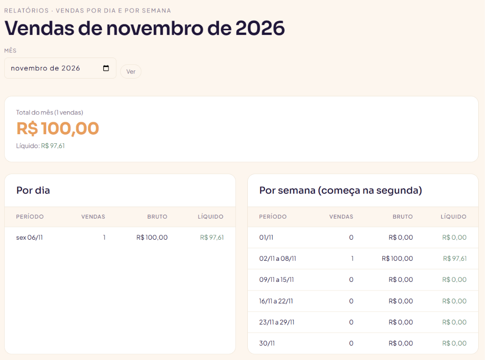

1. Em **Relatórios**, toque em **Vendas por dia e por semana**.
2. Escolha o **mês** e toque em **Ver**.
3. Confira o **total do mês** e as tabelas **Por dia** e **Por semana** (a semana começa na segunda-feira), com o número de vendas, o **bruto** e o **líquido**.

### 6.4 Alterações e exclusões

**Para que serve:** saber quem mudou ou apagou um lançamento, quando e por quê. Toda correção, cancelamento e exclusão fica registrada aqui, e ninguém apaga esse registro.

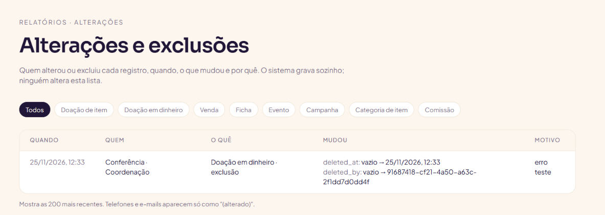

1. Em **Relatórios**, toque em **Alterações e exclusões**.
2. Para ver só um tipo, toque no filtro: **Doação de item**, **Doação em dinheiro**, **Venda**, **Ficha**, **Evento**, **Campanha**, **Categoria de item** ou **Comissão**. **Todos** volta a mostrar tudo.
3. Cada linha mostra **quando**, **quem**, **o quê** (o tipo de registro e se foi alteração ou exclusão), **o que mudou** e o **motivo**.

**Cuidados:**
- A tela mostra as **200 alterações mais recentes**.
- Telefones e e-mails aparecem só como "(alterado)", sem o número ou o endereço.
- Se um lançamento sumiu ou mudou de valor, comece por aqui.

---

## 7. Coordenação: cadastros

**Quem usa:** só a coordenação.

### 7.1 Equipe

**Quem usa:** Coordenação. No menu lateral, toque em **Equipe** para abrir a tela **Quem usa o sistema**.

**Cadastrar uma pessoa da equipe**

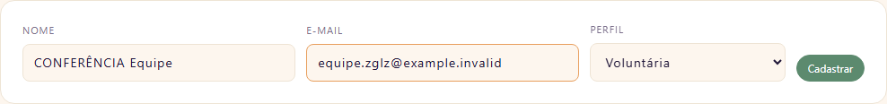

1. No formulário do topo da tela, preencha **Nome** e **E-mail**.
2. Em **Perfil**, escolha **Coordenação**, **Caixa** ou **Voluntária** conforme as tarefas da pessoa. O formulário começa com **Voluntária** selecionada.
3. Toque em **Cadastrar**. A senha provisória aparece no topo da tela uma única vez.
4. Envie por mensagem individual o link do sistema, o e-mail cadastrado e a senha provisória. Toque em **Já anotei** depois de copiar a senha. A pessoa cria a própria senha no primeiro acesso (parte 1).

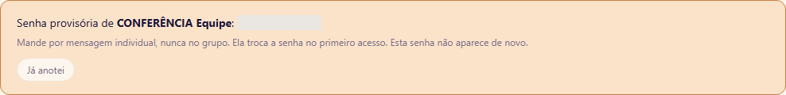

**Alterar o perfil ou o acesso**

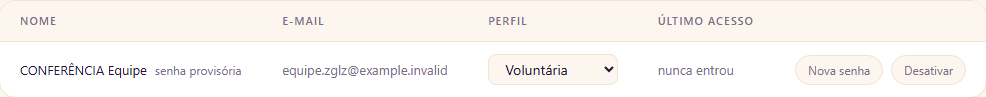

1. Localize a pessoa na lista pelo **Nome** e pelo **E-mail**.
2. Para mudar as permissões de uma conta ativa, escolha o novo **Perfil** na própria linha. A mudança é salva ao selecionar. Confira o perfil exibido na lista.
3. Para bloquear o acesso, toque em **Desativar**. A pessoa fica marcada como **desativada** e o histórico dela continua no sistema. Para devolver o acesso, toque em **Reativar** na mesma linha.

Você só pode desativar contas de outras pessoas. O sistema exige pelo menos uma conta ativa de Coordenação.

**Gerar outra senha provisória**

1. Na linha da conta ativa, toque em **Nova senha**. A senha anterior é substituída pela senha provisória exibida no topo da tela.
2. Envie a senha provisória por mensagem individual e toque em **Já anotei** depois de copiá-la. No próximo acesso, a pessoa deverá criar uma senha própria.

### 7.2 Taxas das maquininhas

**Para que serve:** guardar a taxa de cada maquininha, forma de pagamento e bandeira, para o sistema calcular o líquido das vendas e das doações.

1. Em **Relatórios · Taxas**, escolha a **Maquininha**, a forma (débito, crédito à vista, crédito parcelado, PIX) e, quando pedir, a **Bandeira**.
2. Escreva a **Taxa (%)** e toque em **Salvar taxa**.
3. A tabela **Taxas em vigor** mostra a taxa atual de cada combinação e **quem alterou e quando**.

**Cuidados:**
- A taxa nova vale para os lançamentos **a partir de agora**; os antigos continuam com a taxa da época.
- Ninguém apaga uma taxa: para mudar, salve a nova.

### 7.3 Valor do atendimento

**Para que serve:** o valor de um atendimento (hoje, R$ 50), usado em todo o sistema para converter vendas e doações em atendimentos.

1. Em **Relatórios · Atendimento**, veja o **valor em vigor**.
2. Para mudar, escreva o valor novo e salve. Fica registrado **quem alterou e quando**.

### 7.4 Eventos

**Para que serve:** juntar as doações de um evento (bazar, jantar...) e comparar o arrecadado com o custo.

1. Em **Doações · Eventos**, cadastre o evento com nome e data.
2. Na doação em dinheiro, escolha o evento no campo **Evento**.
3. A tela mostra **Arrecadado, custo e diferença**. O custo pode ser informado depois do evento.
4. **Desativar** tira o evento da lista da doação, sem apagar o histórico. **Reativar** traz de volta.

### 7.5 Campanhas

**Para que serve:** juntar as doações de uma campanha com período (por exemplo, Natal) e comparar com o custo.

1. Em **Doações · Campanhas**, cadastre a campanha com nome, período e custo.
2. Na doação em dinheiro, escolha a campanha no campo **Campanha** (uma doação é de um evento **ou** de uma campanha).
3. A tela mostra **Arrecadado, custo e diferença**.
4. **Encerrar** tira a campanha da lista da doação e mantém o histórico; **Reabrir** traz de volta. Campanha com doação não se apaga.

### 7.6 Comissões

*A escrever: Bibiana (quem capta, percentual e marcação nas doações e nas vendas).*

### 7.7 Categorias de doação

*A escrever: Bibiana.*

### 7.8 Aniversariantes

*A escrever: Bibiana.*

### 7.9 Doadores recorrentes

**Para que serve:** acompanhar quem doa todo mês e ver quem parou.

1. Em **Clientes · Doadores recorrentes**, a lista mostra cada pessoa com doação de frequência mensal e se ela está **em dia** ou **interrompida** (não doou no mês).
2. Use o filtro para ver só as interrompidas: é a lista para a coordenação entrar em contato.

**Cuidados:** a pessoa só entra nesta lista se a doação foi registrada com a frequência **mensal** (parte 3.3).

### 7.10 Aprovação do termo de mensagens

**Para que serve:** registrar que o Instituto aprovou o texto do termo de mensagens. Sem essa aprovação, **ninguém** recebe agradecimento, mesmo quem autorizou.

1. Em **Clientes · Agradecimentos**, enquanto o termo não estiver aprovado, aparece o aviso com o botão **Registrar aprovação**.
2. Informe a data da aprovação e, se quiser, uma observação. Toque em **Registrar aprovação**.
3. O aviso some, e os botões de WhatsApp e e-mail aparecem para quem autorizou.

**Cuidados:**
- É feito **uma vez por versão** do termo, pela coordenação, no início do uso.
- O caixa vê o aviso "O termo de mensagens ainda não foi aprovado", mas não aprova.

---

## 8. Perguntas frequentes

**Esqueci a senha.**
A coordenação gera uma senha provisória nova em **Equipe** ("Nova senha"). No próximo acesso, você troca.

**Lancei errado.**
Doação em dinheiro: **Corrigir**. Venda: **cancelar** com motivo e registrar de novo. Doação de item: **editar** ou **excluir**. Tudo fica registrado em Relatórios · Alterações (parte 4).

**A pessoa não quer mais receber mensagens.**
Na ficha dela, **Retirar autorização** (parte 5.3). Ela sai das listas na hora.

**A internet caiu no meio de uma venda.**
Quando voltar, confira **Últimas vendas**, no painel do brechó, antes de registrar de novo. Se a venda está lá, não registre outra vez.

**Por que não aparece o botão do WhatsApp para uma pessoa?**
Ela não autorizou mensagens, autorizou pela versão antiga do termo, não tem telefone com DDD na ficha, ou o termo ainda não foi aprovado pela coordenação. A própria linha diz qual é o caso.
